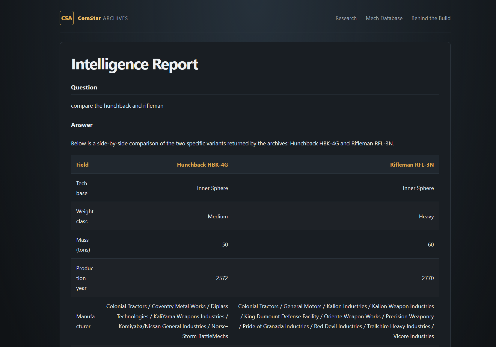

## Portfolio

### Data Science and Machine Learning

Lately I’ve worked on advanced machine learning and NLP applications through DARPA and ARL funded projects. Much of this work involves sensitive information that I cannot publicly share. I built ComStar Archives as a way to demonstrate some of the AI engineering techniques and capabilities I've developed through that work in a publicly accessible project.

ComStar Archives is a full stack BattleTech research assistant combining structured database queries, semantic search, RAG, and LLM tool orchestration to produce evidence grounded answers from a curated knowledge base.

[Live Demo](https://battletech-ai.onrender.com/)

I also built a testing and development environment with a Flask backend and SQL database, featuring user authentication and role based access. It supports real time data visualization, live database queries, and data validation, providing an integrated platform for rapid prototyping, API testing, and database performance evaluation.

I also collaborated on a published research project that used machine learning to estimate solar energy output from readily available data, offering an alternative to methods that rely on expensive physical sensors.

---

### Simulation

I spent several years working in military simulation, developing and supporting AV-8B Harrier training systems. Much of this work took place in classified environments, but these images from an official press release show the types of trainers I worked on. The systems also gained some public attention when Arnold Schwarzenegger famously used them.

---

### Other Projects

Over the years, I’ve explored a wide range of personal projects, everything from games and fractal generators to Boggle solvers and experimental data science tools.

---

Page template forked from <a href="https://github.com/evanca/quick-portfolio">evanca</a>

